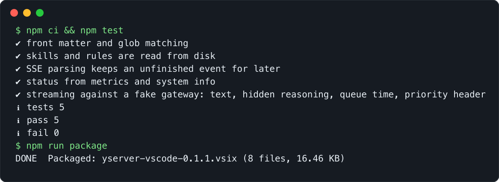

# yserver-vscode

A VS Code extension that lets you ask questions about selected code, and run step-by-step skills on it, using your own self-hosted LLM server (llama.cpp, Ollama, vLLM or any OpenAI-compatible endpoint) instead of a cloud model.



This is real output from a clean checkout. The extension needs a running server to answer questions, so there is no screenshot of an answer here. The tests include a fake server that checks streaming, hidden reasoning, queue time and the priority header.

```text
$ npm ci && npm test
✔ front matter and glob matching
✔ skills and rules are read from disk
✔ SSE parsing keeps an unfinished event for later
✔ status from metrics and system info
✔ streaming against a fake gateway: text, hidden reasoning, queue time, priority header
ℹ tests 5
ℹ pass 5
ℹ fail 0
$ npm run package
DONE  Packaged: yserver-vscode-0.1.1.vsix (8 files, 16.46 KB)
```

## Quick start

The extension is not on the VS Code Marketplace or Open VSX yet (checked 27 November 2026), so build it from source. You need Node.js (CI uses 22) and VS Code 1.90 or newer.

```bash
git clone https://github.com/YauhenBichel/yserver-vscode
cd yserver-vscode
npm ci
npm test
npm run package
code --install-extension yserver-vscode-0.1.1.vsix
```

Then set the address of your server in `settings.json` and reload the window:

```json
{
  "yserver.baseUrl": "http://localhost:8080",
  "yserver.model": "qwen3-coder"
}
```

Select some code and press Cmd+Alt+Y (Ctrl+Alt+Y on Linux and Windows). Type a question. The answer streams into a Markdown document beside your code.

## Commands

Open the command palette and type "yserver". These are read from `package.json`.

| Command | What it does |
|---|---|
| `yserver: Menu` | Shows all actions in one list |
| `yserver: Ask about the selection` | Sends your question and the selected code to the server (Cmd+Alt+Y) |
| `yserver: Run a skill on the selection` | Sends the selection with a skill's method (Cmd+Alt+S) |
| `yserver: Apply the last code block` | Replaces the selection with the last code block of the answer, after you confirm |
| `yserver: Show status` | Shows the model loaded and the queue |
| `yserver: Pause the pipelines` | Pauses background services on the server over SSH |
| `yserver: Resume the pipelines` | Starts them again |
| `yserver: Open a status page` | Opens a page you listed in the settings |
| `yserver: Stop the answer` | Stops the answer that is streaming |

## When to use it

- You run your own model server and want an editor chat and skills without a cloud account.
- You want code to stay on your machine or network.
- You use a gateway with a priority queue and want your editor requests to go first.

## When not to use it

- You have no server. The extension does nothing without one.
- You need inline completions as you type. It only answers about a selection.
- You want it from the Marketplace with automatic updates. It is not published there.

## FAQ

### How do I use a local LLM in VS Code?

Run a server with an OpenAI-compatible API, such as llama.cpp, Ollama or vLLM. Install this extension and set `yserver.baseUrl`. The extension calls `/v1/chat/completions` on that address.

### Does it send my code anywhere?

It sends the selection, your question, the rules and the chosen skill only to the address in `yserver.baseUrl`. If you point it at a cloud API, your code goes there. For pausing services it runs `ssh` to `yserver.sshHost`, only after you confirm.

### How is it different from Continue or Copilot Chat?

It is much smaller: a few commands, no runtime dependencies, and it works on a selection only. It reads rules in Continue's format and runs skills from `SKILL.md` folders. It has no inline completion, no codebase index and no agent mode.

### Where do I get skills?

Clone [engineering-skills](https://github.com/YauhenBichel/engineering-skills) (34 skills) and add its `skills` folder to `yserver.skillsDirs`.

### Does it work with servers other than yserver?

Yes. Any OpenAI-compatible server works for ask and skills. The status bar shows only up or down unless the server also serves `/v1/system` and `/metrics`.

## Features

- **Ask about the selection** (Cmd+Alt+Y, Ctrl+Alt+Y on Linux and Windows): your question and the selected
  code go to the server. The answer streams into a Markdown document beside your code, and it shows when
  the model is still thinking.
- **Run a skill on the selection** (Cmd+Alt+S, Ctrl+Alt+S): pick a skill (debug, review-code,
  write-tests, ...); its step-by-step method goes with the request. Skills are folders of `SKILL.md`
  files, for example [engineering-skills](https://github.com/YauhenBichel/engineering-skills).
- **Apply the last code block:** replaces the selection with the last code block of the answer, after you
  confirm.
- **Stop the answer.**
- **Status bar:** the model loaded on the server and how many requests are waiting. This needs a gateway
  that serves `/v1/system` and `/metrics`; with other servers it shows only whether the server is up.
- **Pause and resume background services** on the server over SSH (`systemctl --user`), after you confirm.
  Useful when batch jobs keep the GPU busy while you code.
- **Open a page:** dashboards or status pages you list in the settings.

Rules in [Continue](https://continue.dev)'s format (Markdown files with `alwaysApply` or `globs`) are sent
with every request, from `yserver.rulesDir`.

Requests carry the header `x-yllm-priority: interactive`, so a gateway with a priority queue serves them
before background work. Other servers ignore it.

## Settings

Search for "yserver" in VS Code's settings. Only `yserver.baseUrl` is required.

| Setting | What it is |
|---|---|
| `yserver.baseUrl` | Address of the server, for example `http://localhost:8080` |
| `yserver.apiKey` | API key, if the server asks for one |
| `yserver.model` | Model name sent with each request |
| `yserver.interactive` | Send `x-yllm-priority: interactive` (default on) |
| `yserver.memory` | Let a gateway with memory add its stored notes (default off: sends `x-yllm-memory: off`) |
| `yserver.maxTokens` | Room for the answer, including a thinking model's hidden reasoning (default 16000) |
| `yserver.skillsDirs` | Folders of skills (`<name>/SKILL.md`) |
| `yserver.rulesDir` | Folder of Markdown rules (default `~/.continue/rules`) |
| `yserver.sshHost` | SSH host of the server, for pausing services |
| `yserver.pipelines` | systemd user services to pause and resume |
| `yserver.pages` | Pages for the menu: `{"label": "url"}` |
| `yserver.refreshSeconds` | How often the status bar updates (default 10) |

Example (`settings.json`):

```json
{
  "yserver.baseUrl": "http://localhost:8080",
  "yserver.model": "qwen3-coder",
  "yserver.skillsDirs": ["~/engineering-skills/skills"]
}
```

## Development

`src/core.ts` holds everything that does not need VS Code (skills, rules, the request, the stream, the
status), with tests in `test/`. `src/extension.ts` is the VS Code part.

## License

Apache-2.0. Part of [yserver](https://github.com/YauhenBichel/yserver-local-llm-system), a home LLM server.
